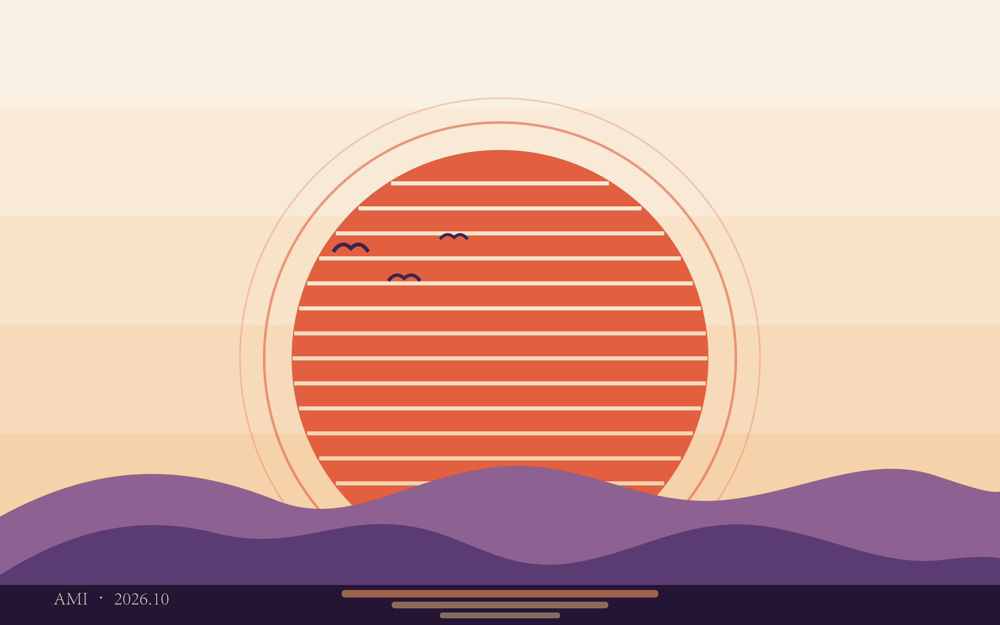

# adobe-ai-mcp · Adobe Illustrator MCP

让 Claude / Codex / 任何支持 MCP 的 AI 助手，直接用 ExtendScript 在 Adobe Illustrator 里画矢量图。

- 画矩形、椭圆、多边形、星形、直线、任意 SVG 路径、文字
- 改样式（填充/描边/线宽/不透明度）、移动、缩放、旋转、删除
- 打开 / 保存 / 关闭文档，导出 PNG / JPG / SVG / PDF / AI
- 导出 PNG 时会把图片直接内嵌返回，AI 画完能"看见"自己的作品
- 兜底工具 `ai_run_script`：直接跑任意 ExtendScript

**零第三方依赖**：Python 标准库 + 系统自带的 Windows PowerShell。
不需要 pywin32，不需要 npm，不需要装 Illustrator 插件。

## 工作原理

```
AI 助手(Codex/Claude)
   │  MCP stdio（换行分隔 JSON-RPC）
   ▼
server.py（Python，20 个工具）
   │  写临时 .jsx → 起 PowerShell
   ▼
scripts/com_bridge.ps1
   │  COM 连接 Illustrator（GetActiveObject / CreateInstance）
   ▼
Adobe Illustrator → app.DoJavaScript(jsx) → 结果写回 → 解析 JSON
```

## 环境要求

- Windows 10 / 11（本工程在 Windows 11 + Illustrator 2026 + Python 3.14 实测通过）
- Adobe Illustrator 2020 或更新版本，已激活
- Python 3.8+（只用到标准库）

## 安装与配置

克隆或拷贝本目录到任意位置，然后按你的客户端挑一种配置（把路径换成你的实际路径）。

**Codex**（`~/.codex/config.toml`）：

```toml
[mcp_servers.adobe_ai]
command = "python"
args = ["C:/Users/you/adobe-ai-mcp/server.py"]
```

**Claude Code**：

```bash
claude mcp add adobe-ai -- python C:/Users/you/adobe-ai-mcp/server.py
```

**Claude Desktop**（`claude_desktop_config.json`）：

```json
{
  "mcpServers": {
    "adobe-ai": {
      "command": "python",
      "args": ["C:/Users/you/adobe-ai-mcp/server.py"]
    }
  }
}
```

重启客户端后，对 AI 说"画一张 800x600 的矩形海报"就能开工。

## 工具清单

| 工具 | 作用 |
| --- | --- |
| `ai_status` | 看 Illustrator 是否安装/运行、版本、打开的文档（不会启动它） |
| `ai_launch` | 启动 Illustrator（首次约 1 分钟） |
| `ai_new_document` | 新建文档/画板，可选单位 pt/px/mm/cm/in 和 RGB/CMYK |
| `ai_add_rect` | 矩形（支持圆角），(x, y)=左上角 |
| `ai_add_ellipse` | 椭圆/圆，(cx, cy)=圆心，rx/ry=半径 |
| `ai_add_polygon` | 正多边形，(cx, cy)=中心，radius=外接半径 |
| `ai_add_star` | 多角星，外半径/内半径/角数 |
| `ai_add_line` | 直线段 |
| `ai_add_path` | SVG path 数据画任意形状（M/L/H/V/C/S/Q/T/Z，相对绝对都行） |
| `ai_add_text` | 文字（字体名可在 `ai_list_fonts` 里查） |
| `ai_set_style` | 改填充/描边/线宽/不透明度（按名字或当前选中） |
| `ai_transform` | 平移/缩放/旋转 |
| `ai_delete` | 删除对象 |
| `ai_list_items` | 列出文档对象和图层 |
| `ai_list_fonts` | 查询可用字体（PostScript 名） |
| `ai_open` / `ai_save` / `ai_close_document` | 文档三件套 |
| `ai_export` | 导出 png / jpg / svg / pdf / ai，PNG/JPG 默认内嵌返回 |
| `ai_run_script` | 直接执行任意 ExtendScript 兜底 |

## 坐标系与颜色

- 原点在**画板左上角**，x 向右，y **向下**，单位是点（pt，72pt = 1 英寸）
- mm/cm/in 只在 `ai_new_document` 里做换算；之后一律用 pt
- 颜色写法：`"#RRGGBB"` / `"none"` / `{"r":255,"g":0,"b":0}` / `{"c":0,"m":100,"y":100,"k":0}` / `{"gray":0.5}`
- 给对象起 `name`，之后 `ai_set_style`、`ai_transform`、`ai_delete` 就能精准点名

## 使用示例（跟 AI 说）

> 新建一个 1200x750 的文档，浅米色背景，右上角画太阳，底部用路径画两座山，
> 中间写一行标题"你好"，然后导出 png 给我看。

AI 会依次调 `ai_new_document` → `ai_add_rect` → `ai_add_ellipse` → `ai_add_path` → `ai_add_text` → `ai_export`，
导出图直接出现在对话里。

## 示例作品

`examples/make_artwork.py` 全程走 MCP 协议画了一张复古日落海报（1200×750，53 个矢量对象），
产出 `artwork_retro_sunset.png`（2x）/ `.svg` / `.ai` 三件套；`tests/` 下两个烟测脚本分别验证桥接层与 MCP 协议全链路。



## 注意事项

- **首次调用会启动 Illustrator**：约 1 分钟，耐心等；之后调用通常 1-3 秒
- Illustrator 里如果有模态弹窗（未保存提示等），脚本会卡住，先处理弹窗
- 建议**串行调用**工具，避免多路 COM 挤在一起
- SVG 路径的圆弧命令 `A` 暂不支持，会退化为直线并给出提醒（圆用 `ai_add_ellipse`）
- **SVG 导出的坑**：Illustrator 的脚本化 SVG 导出会把当前文档关联为该 .svg 文件（文档名改变、关闭时不再提示保存）——这是 Illustrator 自身行为，工具会在返回里给出 warning；要保留可编辑工程，先 `ai_save` 存成 `.ai`
- `ai_export` 的 PNG/JPG 裁剪的是第一个画板
- 字体要用 PostScript 名（如 `MicrosoftYaHei`、`SourceHanSansSC-Regular`），先 `ai_list_fonts` 查

## 许可证

MIT
